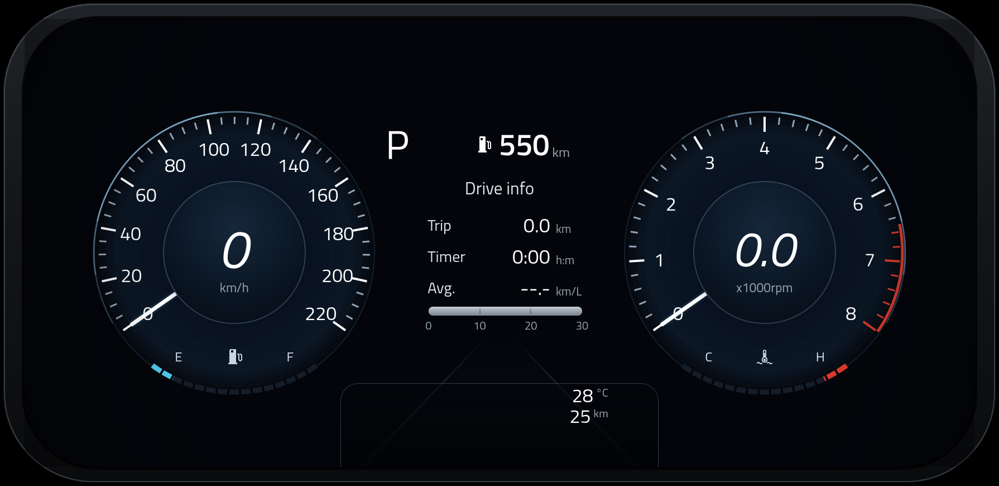
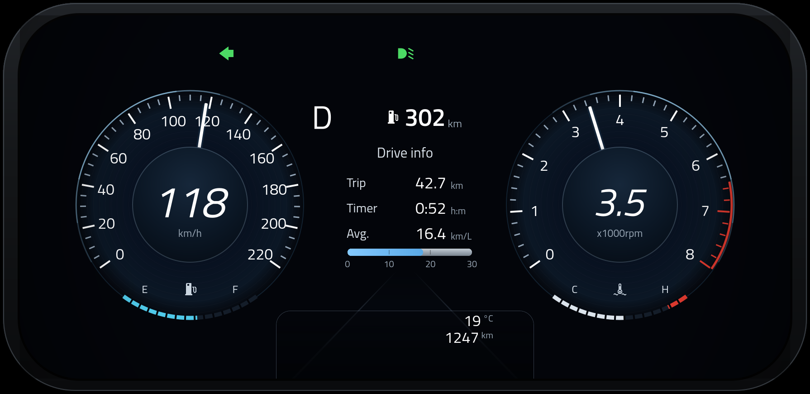

# Car HMI — digital instrument cluster

A working recreation of a modern car's digital instrument cluster, built with
**Qt Quick / QML** and **PySide6**, plus a separate **test panel** window that
feeds it input so every state can be exercised without a car.

Two cluster designs ship, switchable at runtime: **Classic dials**, a
conventional twin-dial cluster, and **BMW chevrons**, a letterboxed
curved-display layout in the style of BMW's Operating System 8. Fourteen
typefaces ship with it, and the artwork re-measures and re-aligns itself
around whichever one is loaded.





---

## Running it

Requires Python 3.9+ on Linux (also runs on macOS and Windows).

```bash
git clone <this repo>
cd hmi
./run.sh
```

`run.sh` creates a local `.venv`, installs PySide6 into it, and launches both
windows. To do it by hand:

```bash
python3 -m venv .venv
source .venv/bin/activate
pip install -r requirements.txt
python3 tools/fetch_fonts.py      # only needed if assets/fonts is empty
python3 main.py
```

On Windows, `run.sh` does not apply — the virtualenv puts its interpreter
somewhere else and Qt Quick Controls defaults to a native style that discards
the panel's styling:

```powershell
py -m venv .venv
.\.venv\Scripts\python.exe -m pip install -r requirements.txt
.\.venv\Scripts\python.exe tools\fetch_fonts.py
$env:QT_QUICK_CONTROLS_STYLE = 'Basic'
.\.venv\Scripts\python.exe main.py
```

### If Qt complains about missing libraries

PySide6 ships Qt itself but still needs a few system libraries. On
Debian/Ubuntu:

```bash
sudo apt install libegl1 libgl1 libxkbcommon-x11-0 libfontconfig1 \
     libdbus-1-3 libxcb-cursor0 libxcb-icccm4 libxcb-keysyms1 \
     libxcb-shape0 libxcb-xkb1 libxcb-render-util0 libxcb-image0
```

On Fedora: `sudo dnf install mesa-libEGL mesa-libGL libxkbcommon-x11 fontconfig`.

### Command line

| Flag | Effect |
| --- | --- |
| `--no-panel` | cluster only, no control panel |
| `--fullscreen` | open the cluster full screen |
| `--scale N` | force the render scale instead of fitting the window |
| `--screenshot FILE` | render one frame to a PNG and exit (works headless) |
| `--font FILE...` | start with your own typeface (files, or a folder of them) |
| `--font-family ID` | start on a bundled typeface (`inter`, `teko`, `rajdhani`, …) |
| `--skin NAME` | which cluster to draw: `classic` or `bmw` |

Keys in the cluster window: **F11** full screen, **Esc** leave full screen,
**B** show/hide the bezel.

---

## The two cluster designs

Switch between them with **Cluster design** at the top of the test panel, or
`--skin` on the command line. Each is drawn on its own fixed canvas and scaled
uniformly to the window, so the window re-proportions itself when you swap.

**Classic dials** (1790x870) — twin round dials with needles, segmented fuel
and coolant arcs, a centre drive-info column and a perspective lane graphic.

**BMW chevrons** (1920x720) — the letterbox layout: two chevron bands facing
each other across the centre, speed and gear pushed out to the far edges, a
media tile between them and a status strip along the bottom. It reads as an
electric car, so the rev counter is replaced by an ePower gauge running from
full recuperation to full power, and the fuel gauge by a state of charge.

Its animation is part of the design, not decoration on top of it:

- a **wake-up sweep** on power-up — both bands run to full scale and back while
  the furniture fades in behind them, the way a real cluster proves its
  instruments;
- gauges **chase** their value with easing rather than snapping, and the scale
  lights up tick by tick as it passes;
- the speed **counts** rather than cuts, so a digit change is legible;
- the gear letter **lifts and settles** when the selection changes;
- drive mode **cross-fades** the accent through the bands, the cover art and
  the mode caption at once — Sport splits it, cold blue on the speed side and
  red on the power side;
- the power band **pulses** near the stop, and recuperation takes its own
  colour below zero;
- indicators, telltales and the charging lamp **blink or breathe**.

The ePower band is a second reading of the same physics rather than a separate
powertrain: demand comes from the throttle, weighted by how much of the motor's
output is going into pushing through drag rather than into acceleration, so the
same pedal reads higher further up the speed range. The negative half is
recuperation — strong under braking, a gentle one-pedal drag on a lift-off, and
fading to nothing as the car stops, because a stationary car recovers nothing.
State of charge follows it, draining under power and recovering under
recuperation, so the percentage in the status strip means something. In
**Manual** the panel's *ePower* and *Charge* sliders drive both directly.

---

## The two windows

**Cluster** — the display itself, scaled uniformly to whatever size the window
is, so proportions never shift.

**Test panel** — the input side. Two ways to drive it:

- **Simulate** (default) runs a small vehicle model. Move the throttle, and
  engine torque goes through the gearbox to the wheels; the car accelerates
  against drag and rolling resistance, the automatic shifts, fuel burns,
  coolant warms up, and the trip computer fills in. The shift interlock is
  modelled too — you cannot leave `P` without the brake and a running engine.
- **Manual** pins `speed` and `rpm` to exact values so you can park the needles
  anywhere for a screenshot or an edge case.

Everything else — fuel, temperatures, lighting, doors, belts, every warning
lamp, cruise control, units — is settable at any time in either mode.

---

## What the cluster shows

**Gauges** — speedometer 0–220 km/h, tachometer 0–8000 rpm with a red band from
6500, segmented fuel and coolant arcs with reserve and overheat zones marked.

**Drive info** — gear (P/R/N/D, plus the held ratio in Sport), distance to
empty, trip distance, trip timer, average and instantaneous economy, odometer,
outside temperature.

**Telltales** — 30 lamps on the conventional severity order (red stop lamps
first, then amber cautions, then blue/green status): brake, park brake, oil
pressure, charging, coolant temperature, airbag, seatbelts, doors ajar, forward
collision, check engine, ABS, ESC and ESC off, traction off, EPS, TPMS, low
fuel, washer fluid, glow plug, immobiliser, lane departure, rear fog, high and
low beam, position lights, front fog, cruise control set and ready. Unlit lamps
take up no space, so an idle cluster shows an empty strip.

**Units** — metric or imperial throughout, and km/L, L/100km or mpg for economy.

**Drive modes** — Comfort, Eco, Sport and Smart, each with its own accent
colour; Eco and Sport also change the shift points and fuel burn.

---

## Typefaces

The **Typeface** dropdown in the test panel switches the cluster between the
fourteen families in `assets/fonts/catalog.json`, each row set in itself so the
list shows what it is offering rather than describing it. The whole cluster
restyles immediately — numerals, gauge labels, drive info, odometer, everything.

### What ships, and why

Instrument clusters are a specialist typographic problem: they are read at a
glance, backlit, at an angle, by a driver who should be looking at the road.
Research by [MIT AgeLab with Monotype][mit] found the square grotesques the
industry reached for by reflex cost 12% in glance time against humanist
designs — around 50 feet of braking distance at speed — which is why several
of the faces below are humanist rather than the obvious "tech" choice.

The faces the manufacturers actually ship are proprietary and cannot be
redistributed: Monotype's [Burlingame][mono] (drawn against that research),
Tipperary and Daytona, Frutiger, BMW Type Next, Hyundai Sans. Everything here
is instead SIL OFL 1.1 or Apache 2.0, chosen either because a manufacturer
genuinely uses it or because it is the closest open stand-in for one that
cannot be shipped — and the catalogue's `note` field says which.

| Family | Style | Why it is here |
| --- | --- | --- |
| Titillium Web | Humanist | The face the artwork was drawn against; the reference for everything below |
| **Inter** | Neo-grotesque | **TATA.ev's brand typeface** — Tata chose this open family outright for the EV identity |
| Roboto | Neo-grotesque | Android Automotive OS default, so it is under a lot of real clusters |
| **Rajdhani** | Squarish | Indian Type Foundry; squared technical face, Devanagari + Latin |
| **Khand** | Condensed | Indian Type Foundry; condensed, tall figures, Devanagari + Latin |
| **Teko** | Condensed | Indian Type Foundry; very narrow — big numbers in little space |
| IBM Plex Sans | Neo-grotesque | Closest open stand-in for BMW Type Next |
| Archivo | Grotesque | Wide apertures at small sizes — the Frutiger/Burlingame school |
| Barlow | Grotesque | Low-contrast, slightly rounded; reads well backlit |
| Saira | Technical | Width axis, suits wide gauge faces |
| Chakra Petch | Squarish | Cut corners and square bowls — the sport-cluster look |
| Exo 2 | Technical | Contemporary technical sans |
| Orbitron | Display | Geometric display face; the EV/concept cliche |
| Oxanium | Display | Angular, chamfered — echoes the BMW chevrons |

On the Indian manufacturers specifically: Tata Motors' own wordmark is set in a
Helvetica-style grotesque, but **TATA.ev** moved to Inter, an open variable
family, explicitly for accessibility and file size — so that one is not an
approximation, it is the real thing. Maruti Suzuki's wordmark is an extended
geometric grotesque (Helvetica/Swiss 721 Black Extended territory) and
Mahindra's is a condensed geometric custom; Rajdhani, Khand and Teko are all
from the Indian Type Foundry and cover that idiom, with Devanagari as a bonus.

[mit]: https://www.ai-online.com/2015/04/the-science-behind-display-fonts-for-in-car-screens/
[mono]: https://www.monotype.com/resources/fonts-cars

### The layout re-aligns itself

Swapping a typeface is not just a family name. Across the catalogue, cap height
spans 0.63–0.73 em, ascent 0.79–1.14 em, and the advance of a digit 0.39–0.83
em — Orbitron's figures are more than **twice** the width of Teko's at the same
nominal size. Dropped into artwork with hard-coded coordinates, that would look
broken three separate ways, so three separate things happen:

- **Optical size.** `FontManager` measures the active face and publishes a
  `capScale`; `Theme.px()` multiplies by it, so every face draws capitals at
  the same height rather than the same nominal pixel size.
- **Vertical position.** Qt centres text on its line box, which is ascent plus
  descent — and faces reserve wildly different room for accents they may never
  draw. `Theme.capDy()` returns the nudge that puts the middle of the *capital
  band* back where the reference face had it. Where one run has to sit on
  another's baseline, it anchors to `baseline` so Qt does the arithmetic from
  the real metrics instead of a guessed fraction.
- **Width.** Readouts with a hard limit on their slot carry a `fitWidth` and
  shrink rather than overrun it, and figures are set with tabular numerals so a
  changing readout does not shuffle sideways.

The net effect: `--font-family orbitron` and `--font-family teko` put every
numeral, label and unit in the same place and at the same apparent size as the
default, despite a 2.1x difference in figure width between them.

### Loading your own

- **Load font…** opens a file picker. Select a family's several styles at once
  (regular, italic, bold) — the cluster asks for italic numerals and a
  demi-bold range, so Qt otherwise has to synthesise them from the regular.
- Or type a path into the field and press **Apply**. A folder works too: every
  font file in it is loaded.
- **Use bundled** goes back to Titillium Web.

A face loaded from disk is measured and aligned exactly like a bundled one.

`.ttf`, `.otf`, `.ttc`, `.woff` and `.woff2` all work. The panel shows the
family name it resolved, a live preview in that font, and an explanatory
message if a file could not be read.

Your choice is remembered, so the cluster comes back up in your font next
time. If that file later moves or is deleted, the cluster falls back to the
bundled typeface and says so rather than failing to start.

You can also set it from the command line, which is handy for screenshots:

```bash
python3 main.py --font-family rajdhani
python3 main.py --font ~/fonts/Inter-Regular.ttf ~/fonts/Inter-Italic.ttf
python3 main.py --font ~/fonts/my-brand-family/
python3 tools/shoot.py shot.png --font-family teko --set skin=bmw speed=120
```

To add a family, put an entry in `assets/fonts/catalog.json` and run
`python3 tools/fetch_fonts.py` — it pulls the files from the upstream
`google/fonts` repository and refuses anything that is not really a font.

The control panel deliberately keeps the bundled font for its own labels. If
a loaded font turned out to be a symbol or display face, a panel rendered in
it would leave you no way to read the button that undoes the change.

---

## Layout

```
main.py                 entry point: registers fonts, model and QML
backend/
  vehicle.py            VehicleState — every cluster signal as a Qt property
  simulator.py          engine, gearbox, road load, fuel, trip computer
  fonts.py              FontManager — the catalogue, custom faces, and metrics
qml/
  Main.qml              the two windows
  Hmi/
    Theme.qml           classic geometry and colour, plus the font adaptation
    BmwTheme.qml        BMW geometry and colour, and the chevron polygon
    Fmt.qml             unit conversion and display formatting
    ClusterText.qml     text that holds its size and place across typefaces
    ClusterWindow.qml   hosts whichever skin is selected, and scales it
    ClusterScene.qml    composes the classic display
    Dial.qml            face, rim, ticks, needle, readout
    TickRing.qml        tick marks and numerals
    MiniArcGauge.qml    the fuel / coolant arcs
    CenterPanel.qml     gear, range, drive info, eco bar
    LaneGraphic.qml     perspective lane markings
    BottomBar.qml       outside temperature and odometer
    BmwScene.qml        composes the BMW display, and its animation
    BmwGauge.qml        one chevron gauge: band, scale, bloom, caption
    BmwChevron.qml      the lit band, drawn twice so it can glow and stay crisp
    BmwMediaTile.qml    cover art, track, progress
    BmwStatusBar.qml    charge, clock, mode, temperature, range
    TelltaleBar.qml     the warning lamp strip, shared by both skins
    ControlWindow.qml   the test panel, including the typeface dropdown
assets/
  fonts/
    catalog.json        the fourteen families, with licence and provenance
    <Family>/           the font files themselves, plus each one's licence
  icons/                generated telltale symbols
tools/
  fetch_fonts.py        downloads everything in catalog.json
  make_icons.py         regenerates assets/icons
  shoot.py              headless screenshot of any cluster state
  smoke_test.py         drives the simulator and checks it behaves
```

### Adjusting the artwork

`qml/Hmi/Theme.qml` and `qml/Hmi/BmwTheme.qml` hold every coordinate, radius,
font size and colour their cluster draws with, in design-canvas pixels. Nothing
else contains a magic number, so moving an element is a one-line change there.

Sizes in those files are *design* sizes, quoted against the reference face. Set
text with `ClusterText`'s `designSize` rather than `font.pixelSize`, and where
the artwork centres text on a coordinate add `Theme.capDy(designSize)` to the
`y`, so it keeps working when the typeface changes underneath it.

---

## Development

Render any state to a PNG without a display:

```bash
python3 tools/shoot.py shot.png --set speed=118 rpm=3450 gearMode=D \
    headlightMode=2 turnLeft=true blinkOn=true fuelLevel=0.55 coolantTemp=92
```

Check the simulation still behaves:

```bash
python3 tools/smoke_test.py
```

Regenerate the telltale icons after editing `tools/make_icons.py`:

```bash
python3 tools/make_icons.py
```

---

## Notes on fidelity

The cluster is modelled on a Hyundai-style twin-dial display. Two details in
the source photograph are internally inconsistent — it shows 550 km of range
next to an almost-empty fuel arc, and a cold engine next to a marked red zone
on the coolant arc. Both are resolved here in favour of a cluster that
behaves correctly: the coloured band at the `H` end is the fixed overheat
zone, the fuel arc shows the live level, and range is computed from the fuel
remaining once the engine has run. At rest the display reproduces the
reference frame — `P`, 550 km, 0 km/h, 0.0 rpm, 28 °C, 25 km.

## Licence

Code is yours to use. Titillium Web is under the SIL Open Font License; see
`assets/fonts/OFL.txt`.
